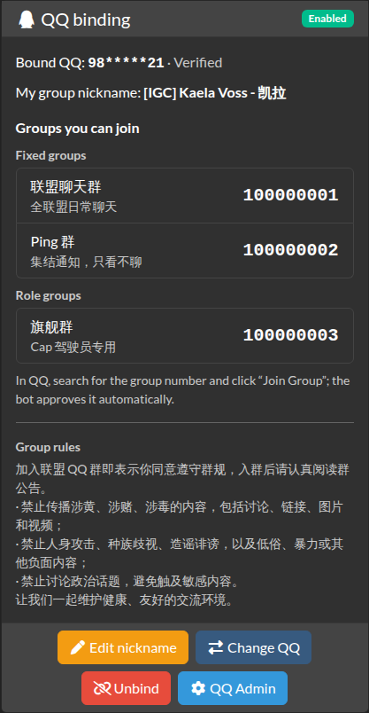

# aa-qqbot

English | [简体中文](README.zh-CN.md)

A QQ group membership plugin for Alliance Auth. Members bind their QQ number on AA's Services page. A QQ bot (the Koishi plugin [koishi-plugin-aaqqbot](https://github.com/yilifaer/Koishi-AAqqbot-plugin), also on [npm](https://www.npmjs.com/package/koishi-plugin-aaqqbot); a separate project) asks AA's API who may join and stay in each group.

This is a complete rewrite of [QQMonitor](https://github.com/Leitowow/QQMonitor). No code is shared with it and its bindings are not imported, so everyone binds again.

- Members already in a group: enter your QQ number, no code needed (during the first 30 days after the group is added; configurable)
- New members: get a one-time code and put it in the QQ join request
- QQ managers handle groups, bindings and conflicts on the "QQ Admin" page in the sidebar



## Requirements

- Alliance Auth 5.2, 5.3, 5.4 or 5.5 (each is tested)
- Python 3.10+

## Installation

Run everything inside AA's virtual environment, in the `myauth` directory.

1. Install the plugin:

```bash
pip install git+https://github.com/yilifaer/aa-qqbot-plugin.git@v1.1.0
```

2. Generate a secret for the bot. Keep the output; you need it in the next step and for the bot:

```bash
python -c "import secrets; print(secrets.token_urlsafe(48))"
```

3. Add this to the end of `local.py`, and replace `your-secret` with the secret from step 2:

```python
from celery.schedules import crontab

INSTALLED_APPS += ["qqbot"]
APPS_WITH_PUBLIC_VIEWS += ["qqbot"]  # required by the bot API; append, do not overwrite

QQBOT_API_KEYS = {
    "koishi-1": "your-secret",
}

CELERYBEAT_SCHEDULE["qqbot_reconcile"] = {
    "task": "qqbot.tasks.reconcile",
    "schedule": crontab(minute="17", hour="4"),
}
```

The key id (`koishi-1` above) is not a secret, but it should not be easy to guess.

4. Check the configuration, then migrate:

```bash
python manage.py check
python manage.py migrate
```

The configuration is fine when `check` prints no messages starting with `qqbot.`. (`qqbot.W003` only appears if you set the optional `QQBOT_AUDIT_RETENTION_DAYS`, see Data protection, to a value that is not used as written.)

5. Restart AA:

```bash
sudo supervisorctl restart myauth:
```

6. In the Django admin, give the two permissions. The picker box is narrow, so search for each one separately:
   - Search `QQ binding: member` and add it to the Member state (codename `qqbot.basic_access`).
   - Create a group for your QQ managers (e.g. "QQ Managers"), search `QQ binding: manager` and add it to that group (codename `qqbot.manage`), then add the manager accounts to the group under Users.

After step 6, members see a card titled "QQ binding" on the Services page. QQ managers get a "QQ Admin" entry in the sidebar, where they add the QQ groups to manage.

There is no corporation or CEO permission tier on purpose. The plugin only links QQ numbers to AA accounts and asks AA's own states and groups who may be in each QQ group, so CEOs and directors need no extra role. The manager permission is meant for a small group of people who run the QQ groups and handle conflicts.

## Upgrade

```bash
pip install --upgrade --force-reinstall --no-deps git+https://github.com/yilifaer/aa-qqbot-plugin.git@v1.1.0
python manage.py migrate
```

Then restart AA. For a newer release, replace `v1.1.0` with its tag; [CHANGELOG.md](CHANGELOG.md) lists the versions.

## Uninstall

Stop AA, then run (this deletes all bindings and the audit log):

```bash
python manage.py migrate qqbot zero
python manage.py shell -c "from django_celery_beat.models import PeriodicTask; PeriodicTask.objects.filter(name='qqbot_reconcile').delete()"
```

Remove the lines you added to `local.py`, then run this. It deletes only this plugin's 9 content types and 2 permissions:

```bash
pip uninstall -y aa-qqbot
python manage.py shell -c "from django.contrib.contenttypes.models import ContentType; print(ContentType.objects.filter(app_label='qqbot').delete())"
```

Do not use `python manage.py remove_stale_contenttypes --include-stale-apps` instead: it also deletes the permissions left behind by every other plugin ever uninstalled from this AA.

Start AA.

## Data protection

What the plugin keeps about people, who can see it and for how long:

| Data | Who can see it | How long |
|---|---|---|
| Bindings: QQ number, nickname, status, group nickname set by a manager | the member (QQ partly masked); QQ managers and superusers (in full) | until unbind; deleted with the AA user |
| Verification code requests: the QQ typed (it may be someone else's), the nickname and a hash of the code | only the member, for their own pending code (not shown to managers) | 7 days after the code expired, was used or was cancelled; deleted with the AA user |
| Member lists reported by the bot: the QQ of everyone in a managed group, **including people without an AA account** | QQ managers (the "not bound" list) | until the bot's next full report for that group, or until the group is deleted |
| Event outbox: change type and QQ | the bot | 30 days |
| Audit log: who did what to which QQ (usernames, nicknames, QQ of applicants and of other claimants) | QQ managers, superusers | forever by default, also after the AA user is deleted |
| Session data: the code, QQ and nickname the member just typed | the member | until the card shows that the code is gone, or the session ends |
| Log lines: usernames and masked QQ numbers; for refused API calls the IP address, the proxy headers (`X-Forwarded-For`, `X-Real-IP`, `CF-Connecting-IP`) and the key id if it is configured | admins who can read AA's log files | as set in your logging configuration |

Events and old codes are deleted only when the daily reconcile runs (the `qqbot_reconcile` entry from step 3, or `python manage.py qqbot_reconcile`).

What leaves AA: for each QQ the bot asks about, AA answers with the decision and, for bound members, the group nickname (corporation ticker, character name, nickname). What the bot keeps is outside this plugin.

**Limit the audit log.** Optional, in `local.py`:

```python
QQBOT_AUDIT_RETENTION_DAYS = 365  # default 0: keep forever
```

The daily reconcile then deletes audit log entries older than that many days. The minimum is 30 (1-29 count as 30) because the rebind cooldown reads the audit log. `python manage.py check` reports `qqbot.W003` when the value is neither 0 nor a whole number of at least 30; a value that is not a whole number, or is below 0, is ignored and the log is kept forever. Deleting an entry also ends the restriction it recorded: a member whose QQ a manager force-unbound needs a verification code to bind it again only as long as that entry exists.

**Deletion requests.** First remove the binding: the member unbinds, a QQ manager force-unbinds, or the AA user is deleted (the binding is deleted with the user). Then, in AA's virtual environment:

```bash
python manage.py qqbot_erase --qq 12345678 --user some-username --dry-run
python manage.py qqbot_erase --qq 12345678 --user some-username
```

- Give `--qq` and / or `--user` (the AA username; it also works after the AA user was deleted, because the audit log keeps usernames).
- `--dry-run` only shows what would change. Otherwise the command asks you to type `yes`; `--noinput` skips the question.
- It refuses while a binding for that QQ or that user exists.
- In one transaction it anonymises the audit log entries about the person, clears them as the actor of the entries they made, replaces their QQ or username in the details of other entries by `[erased]`, and deletes their verification codes, events and member list entries.
- Afterwards the rebind cooldown and the force-unbind restriction no longer know this person, because both are read from the audit log.
- It does not delete the AA user, log files, database backups or what the bot stored. If the person is still in a managed QQ group, the bot reports the QQ again with its next full member list.

## More

- Bot integration: the Koishi plugin [koishi-plugin-aaqqbot](https://github.com/yilifaer/Koishi-AAqqbot-plugin) ([npm](https://www.npmjs.com/package/koishi-plugin-aaqqbot)) is the bot side of this plugin. The API contract for anyone writing a bot is [API.md](API.md); [KOISHI_START.md](KOISHI_START.md) is the original kick-off brief for the Koishi plugin (both in Chinese). The bot needs the API URL (`https://your-aa-site/qqbot/api/v1/`), the key id and the secret.
- Step-by-step guide and troubleshooting: [English](docs/GUIDE.en.md), [Chinese](docs/GUIDE.md)
- If this site ran 0.x of this plugin: before step 3, remove the old `"qqbot"`, `QQBOT_GROUP_CHAT` and `QQBOT_PING_GROUP` from `local.py`. Old bindings are not imported; everyone binds again.
- `NameError: name 'APPS_WITH_PUBLIC_VIEWS' is not defined`: your `local.py` is older than the AA 5 template. Add this line above the block from step 3:
  ```python
  APPS_WITH_PUBLIC_VIEWS = []
  ```
- On AA 5.2/5.3, if every page fails with an error mentioning `sri_static`, run this and restart:
  ```bash
  pip install "django-sri<1"
  ```
- On AA 5.2–5.4, if AA stops starting with `ModuleNotFoundError: No module named 'httpx'` (pip upgraded `django-esi` to 10.x, which only AA 5.5 supports), run this and restart, or upgrade AA to 5.5:
  ```bash
  pip install "django-esi<10"
  ```
- Superusers do not get group access automatically; their card then says so. Test with a normal member account.
- Language: the QQ binding card and the QQ Admin pages are in Chinese for users whose AA language is Chinese, and in English for everyone else. Members who never picked a language get their browser's language; anyone can pick a language in AA's language menu (AA remembers it). The default group rules text is in Chinese; edit it under QQ Admin → Settings.

## License

MIT
