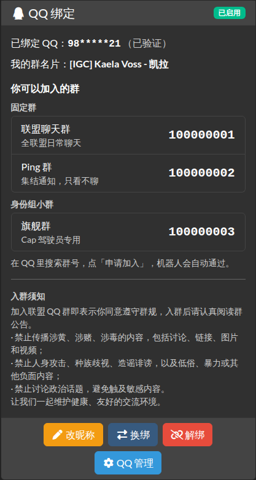

# aa-qqbot

[English](README.md) | 简体中文

Alliance Auth 的 QQ 群成员管理插件。成员在 AA 的「服务」页绑定 QQ，QQ 机器人（Koishi 插件 [koishi-plugin-aaqqbot](https://github.com/yilifaer/Koishi-AAqqbot-plugin)，也可在 [npm](https://www.npmjs.com/package/koishi-plugin-aaqqbot) 上找到；另一个项目）通过接口向 AA 查询谁可以进群、留在群里。

这是 [QQMonitor](https://github.com/Leitowow/QQMonitor) 插件的完全重写，代码没有沿用，旧的绑定数据也不导入，所有人需要重新绑定。

- 已经在群里的老成员：填 QQ 号就生效，不用验证码（群添加后的前 30 天内有效，可在「QQ 管理」→「设置」里的「老成员免验证过渡期（天）」改）
- 新成员：拿到验证码，申请入群时填在「验证信息」里
- QQ 管理员在侧边栏「QQ 管理」里管理群、绑定和冲突



## 环境要求

- Alliance Auth 5.2、5.3、5.4 或 5.5（每个版本都有自动测试）
- Python 3.10+

## 安装

以下命令都在 AA 的虚拟环境里、`myauth` 目录下执行。

1. 安装插件：

```bash
pip install git+https://github.com/yilifaer/aa-qqbot-plugin.git@v1.1.0
```

2. 生成机器人密钥。记下输出的这一串，下一步要用，之后还要交给机器人那边：

```bash
python -c "import secrets; print(secrets.token_urlsafe(48))"
```

3. 在 `local.py` 末尾加上下面这段，把 `这里换成生成的密钥` 换成第 2 步生成的密钥：

```python
from celery.schedules import crontab

INSTALLED_APPS += ["qqbot"]
APPS_WITH_PUBLIC_VIEWS += ["qqbot"]  # 机器人接口需要；用 +=，不要覆盖

QQBOT_API_KEYS = {
    "koishi-1": "这里换成生成的密钥",
}

CELERYBEAT_SCHEDULE["qqbot_reconcile"] = {
    "task": "qqbot.tasks.reconcile",
    "schedule": crontab(minute="17", hour="4"),
}
```

密钥编号不是秘密，但也不要让人容易猜到：加上几个随机字符，例如 `koishi-7f3a`（上面的 `koishi-1` 只是示例）。

4. 检查配置，然后建表：

```bash
python manage.py check
python manage.py migrate
```

`check` 没有 `qqbot.` 开头的提示就说明配置对了。（`qqbot.W003` 只在你设置了可选的 `QQBOT_AUDIT_RETENTION_DAYS`、见「数据保护」，而且取值不会按写的生效时才出现。）

5. 重启 AA：

```bash
sudo supervisorctl restart myauth:
```

6. 在 Django 后台分配两个权限（权限选择框比较窄，两个权限分开搜）：
   - 搜索 `QQ 绑定 - 成员`（或 `QQ binding: member`），加到 Member 状态上（权限代码 `qqbot.basic_access`）。
   - 新建一个 QQ 管理员组（例如「QQ 管理」），搜索 `QQ 绑定 - 管理员`（或 `QQ binding: manager`）加到这个组上（权限代码 `qqbot.manage`），再在「Users」里把管理员账号加进这个组。

完成后，成员在「服务」页能看到「QQ 绑定」卡片，QQ 管理员的侧边栏会出现「QQ 管理」。然后由 QQ 管理员在「QQ 管理」→「QQ 群」里添加要管理的群。

这里没有「军团」或 CEO 这一级权限，是有意的：插件只负责把 QQ 号和 AA 账号对应起来，谁能进哪个 QQ 群由 AA 自己的状态（State）和组（Group）决定，所以 CEO、总监不需要额外的角色。管理员权限是给少数负责管理 QQ 群、处理冲突的人用的。

## 升级

```bash
pip install --upgrade --force-reinstall --no-deps git+https://github.com/yilifaer/aa-qqbot-plugin.git@v1.1.0
python manage.py migrate
```

然后重启 AA。升级到更新的版本时，把 `v1.1.0` 换成新版本号；各版本见 [CHANGELOG.md](CHANGELOG.md)。

## 卸载

先停掉 AA，然后执行（会删除所有绑定和操作记录）：

```bash
python manage.py migrate qqbot zero
python manage.py shell -c "from django_celery_beat.models import PeriodicTask; PeriodicTask.objects.filter(name='qqbot_reconcile').delete()"
```

删掉 `local.py` 里加的那几行，然后执行下面两行（只删除本插件的 9 个内容类型和 2 个权限）：

```bash
pip uninstall -y aa-qqbot
python manage.py shell -c "from django.contrib.contenttypes.models import ContentType; print(ContentType.objects.filter(app_label='qqbot').delete())"
```

不要改用 `python manage.py remove_stale_contenttypes --include-stale-apps`：它会把这台 AA 上所有已卸载插件留下的权限一起删掉。

最后启动 AA。

## 数据保护

插件保存了哪些关于人的数据、谁能看到、保留多久：

| 数据 | 谁能看到 | 保留多久 |
|---|---|---|
| 绑定：QQ 号、昵称、状态、管理员指定的群名片 | 成员本人（QQ 号部分打码）；QQ 管理员和超级管理员（完整） | 解绑为止；AA 用户被删除时一并删除 |
| 验证码申请：填写的 QQ（可能是别人的）、昵称和验证码的哈希 | 成员本人能看到自己待验证的验证码；QQ 管理员看不到验证码，但填写的 QQ 会出现在操作记录里（「生成验证码」） | 验证码过期、被使用或被取消 7 天后；AA 用户被删除时一并删除 |
| 机器人上报的群成员名单：每个受管群里所有人的 QQ，**包括没有 AA 账号的人** | QQ 管理员（「待处理」里的「群里有、但没有绑定的 QQ」列表） | 到机器人下一次上报这个群的完整名单为止，或者这个群被删除为止；被停用的群不再有上报，最后一份名单会一直留着（界面上不显示），直到这个群被删除 |
| 事件发件箱：变更类型和 QQ | 机器人 | 30 天 |
| 操作记录（审计日志）：谁对哪个 QQ 做了什么（用户名，包括其他认领者和冲突中胜出者的；昵称；换绑前的 QQ；拿别人验证码来申请的人的 QQ） | QQ 管理员、超级管理员 | 默认永久保留，AA 用户被删除后也保留 |
| session 数据：成员刚填写的验证码、QQ 和昵称 | 成员本人 | 到卡片显示验证码已经失效为止，或者 session 结束为止；操作结果提示在成员下次打开「服务」页时删除，超过 5 分钟不再显示 |
| AA 的缓存（Redis）：成员在卡片上当前这一小时里试过的 QQ 号（用于限制尝试的 QQ 号个数，最多 5 个，可能是别人的 QQ）；被拒绝的接口请求的来源地址（用于日志限流） | 谁都看不到 | QQ 号在 1 小时内过期，来源地址 60 秒后过期 |
| 日志行：用户名和打码的 QQ 号；被拒绝的接口请求还有 IP 地址、代理头（`X-Forwarded-For`、`X-Real-IP`、`CF-Connecting-IP`）和密钥编号（已配置的才记）；同一个错误代码、同一个来源地址每分钟最多记一行（请求方法不对、返回 405 的请求按同样的规则限流） | 能读 AA 日志文件的管理员 | 按站点的日志配置 |

事件和过期的验证码只在每日对账运行时才会删除（第 3 步的 `qqbot_reconcile` 定时任务，或手动运行 `python manage.py qqbot_reconcile`）。

离开 AA 的数据：机器人问到某个 QQ 时，AA 回答判定结果；已绑定成员还会给出群名片（军团简称、角色名、昵称）。事件接口还会把每次绑定变更的类型和 QQ 交给机器人（保留 30 天）。机器人那边保存了什么，不在本插件的管辖范围内。

**限制操作记录的保留时间**：可选设置，写在 `local.py` 里：

```python
QQBOT_AUDIT_RETENTION_DAYS = 365  # 默认 0：永久保留
```

设置后，每日对账会删除早于这么多天的操作记录（手动运行 `python manage.py qqbot_reconcile` 会显示删除了多少条）。最少 30 天（填 1–29 按 30 天算），因为换绑冷却要读操作记录。既不是 0、也不是不小于 30 的整数时，`python manage.py check` 会报 `qqbot.W003`；不是整数、或者小于 0 的值会被忽略，操作记录仍然永久保留。删除一条记录，它记录的限制也跟着结束：被管理员强制解绑过某个 QQ 的成员，再绑这个 QQ 必须用验证码，这条限制只在那条记录还在的时候有效。

**删除请求**：先去掉这个 QQ 和这个用户的所有绑定：成员自己解绑，或 QQ 管理员强制解绑，或删除 AA 用户（绑定会跟着一起删除）。然后在 AA 的虚拟环境里：

```bash
python manage.py qqbot_erase --qq 12345678 --user some-username --dry-run
python manage.py qqbot_erase --qq 12345678 --user some-username
```

- `--qq` 和 / 或 `--user`（AA 用户名；AA 用户已经被删除后也能用，因为操作记录里留着用户名），至少给一个。`--user` 按记录里保存的用户名匹配，所以已删除的账号如果曾经用过同一个用户名，它的记录也会被匹配到。
- `--dry-run` 只显示会改动什么，并列出在这个 QQ 上有记录的其他账号（见下）。不加时命令会要求输入 `yes` 确认；`--noinput` 跳过确认。
- 这个 QQ 或这个用户只要还有任何绑定，命令就拒绝执行，包括别的账号对同一个 QQ 的绑定（例如冲突的另一方，或认领过这个 QQ 的人）；报错信息会列出它们。请先去掉这些绑定。
- 在一个事务里匿名化关于此人的操作记录（目标是他的 AA 账号或用户名，或者记录在这个 QQ 上、没有目标账号）：QQ、目标和详情都清空。此人作为操作者的记录里，操作者显示为 `[erased]`。
- 这个 QQ 上属于其他账号的记录（例如没用验证码就认领了这个 QQ、后来被管理员强制解绑的人）保留（包括 QQ 和目标账号），其中指向此人的字段（其他认领者、胜出的账号、申请人的 QQ）同样换成 `[erased]`。它们记录的是那些账号做过什么，也让那个账号的强制解绑限制和换绑冷却继续有效。如果其中某个账号其实就是此人，请再加上 `--user` 运行一次。
- 在其他所有记录里，同样只把指向此人的字段替换为 `[erased]`：其他认领者的用户名、冲突中胜出的账号、拿别人验证码来申请的人的 QQ。
- 删除这个 QQ 的所有验证码申请（不论是哪个账号填的，别人对这个 QQ 待验证的验证码也会作废）以及此用户的验证码申请，还有这个 QQ 的事件发件箱记录和群成员名单记录。`--user` 对应一个现存的 AA 用户时，还会删除缓存里这个用户的 QQ 尝试记录（见上表）；缓存里的其他记录一小时内自己过期。如果删掉了事件，会再添加一条“全部重查”事件（不带 QQ），让机器人尽快把所有群重新检查一遍，不需要另外等待。
- 之后换绑冷却和强制解绑限制都不再知道这个人，因为它们都是读操作记录的。
- 不会删除 AA 用户、日志文件、数据库备份，也不会删除机器人那边保存的数据。如果此人还在受管的 QQ 群里，机器人下一次上报完整群成员名单时会再次报告这个 QQ。

## 其他

- 机器人对接：Koishi 插件 [koishi-plugin-aaqqbot](https://github.com/yilifaer/Koishi-AAqqbot-plugin)（[npm](https://www.npmjs.com/package/koishi-plugin-aaqqbot)）就是本插件对应的机器人。自己写机器人的人看接口合同 [API.md](API.md)；[KOISHI_START.md](KOISHI_START.md) 是当初写这个 Koishi 插件的开工说明。机器人需要接口地址（`https://你的AA网址/qqbot/api/v1/`）、密钥编号和密钥。
- 分步安装说明和常见问题：[中文](docs/GUIDE.md)、[English](docs/GUIDE.en.md)
- 装过本仓库 0.x 旧版的：做第 3 步之前，先删掉 `local.py` 里旧版加的 `"qqbot"`、`QQBOT_GROUP_CHAT` 和 `QQBOT_PING_GROUP`。旧版的绑定不会导入，所有人要重新绑定。
- 报错 `NameError: name 'APPS_WITH_PUBLIC_VIEWS' is not defined`：说明 `local.py` 比 AA 5 的模板旧，在第 3 步那段前面加一行：
  ```python
  APPS_WITH_PUBLIC_VIEWS = []
  ```
- AA 5.2/5.3 所有页面都报 `sri_static` 错误时，执行下面这条后重启：
  ```bash
  pip install "django-sri<1"
  ```
- AA 5.2～5.4 启动时报 `ModuleNotFoundError: No module named 'httpx'`（pip 把 `django-esi` 升到了只有 AA 5.5 才支持的 10.x）时，执行下面这条后重启，或者把 AA 升到 5.5：
  ```bash
  pip install "django-esi<10"
  ```
- 超级管理员不会自动获得入群资格（这时卡片会直接提示），测试时请用普通成员账号。
- 界面语言：「QQ 绑定」卡片和「QQ 管理」页面在用户的 AA 语言是中文时显示中文，其他语言都显示英文（卡片叫 "QQ binding"，菜单叫 "QQ Admin"）。没选过语言的成员按浏览器语言显示，浏览器是英文就会看到英文；让他在 AA 的语言菜单里选「简体中文」即可（AA 会记住）。改 `LANGUAGE_CODE` 没用，因为 Django 先看浏览器的语言。

## 许可证

MIT
